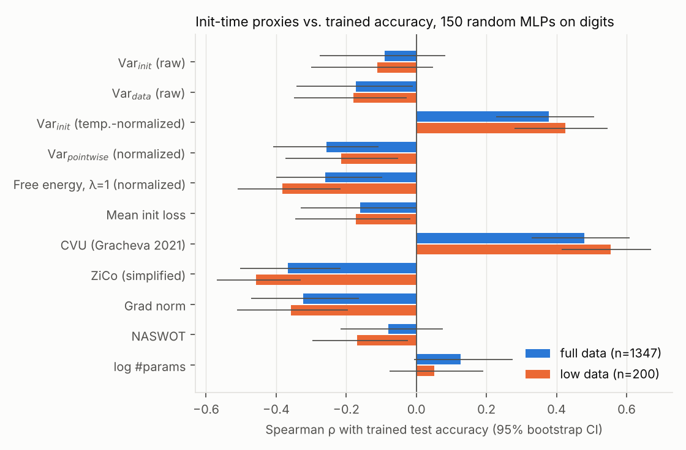
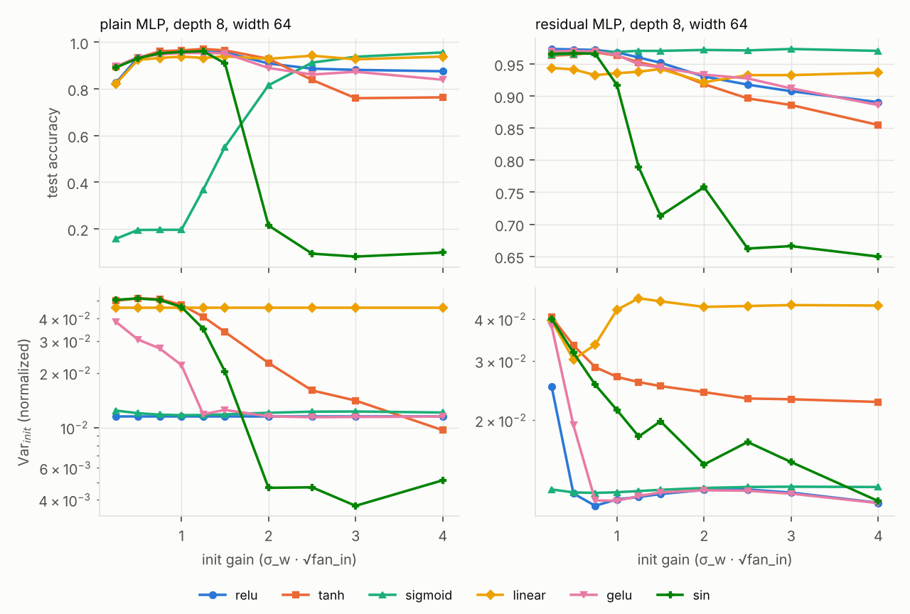
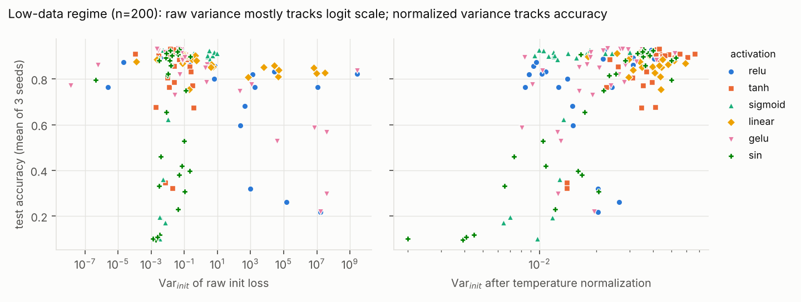

# Init-loss variance as an architecture-quality proxy

**Question.** Does the variance of the loss at initialization, with the
initialization distribution $P_0$ treated as a PAC-Bayes prior, tell us how
good an architecture will be after training?

This repo has a NumPy-only testbed (MLPs with manual backprop, sklearn `digits`
dataset, no downloads), a set of loss-variance proxies with literature baselines,
and three initial experiments. Status: **exploratory**.

## Why this might work: a PAC-Bayes motivation

Let $\hat L(\theta)$ be the empirical risk on $n$ examples and $\theta\sim P_0$ the
init distribution. The minimum over posteriors $\rho$ of the Catoni-style objective
$\mathbb E_\rho \hat L + \mathrm{KL}(\rho\|P_0)/(\lambda n)$ is attained by the Gibbs
posterior. Its value is the **free energy**

$$F(\lambda) = -\tfrac{1}{\lambda n}\log \mathbb E_{\theta\sim P_0}\, e^{-\lambda n \hat L(\theta)}
\;=\; \mu_0 - \tfrac{\lambda n}{2}\,\sigma_0^2 + O(\kappa_3),$$

where $\mu_0,\sigma_0^2$ are the **mean and between-init variance of the
empirical risk under the prior**. So at a fixed mean init loss, *larger* variance
means more prior mass at low loss, which means a tighter bound. This is the
opposite direction from the "stable architectures are better" intuition in the
earlier literature (below). Both quantities can be estimated with forward passes
only.

The law of total variance splits the loss variance into a between-init part
(`var_init`, the one PAC-Bayes cares about) and a within-init, across-example part
(`var_data`). The two can behave very differently.

## Related work and novelty

| Work | What it measures at init | Relation |
|---|---|---|
| Gracheva 2021, *Array* ("CVU") | CV of **untrained accuracy** over many random inits; lower CV reported as better on NAS-Bench-201 | Closest prior work. Same idea (dispersion over inits), but uses accuracy and no PAC-Bayes link |
| Gracheva 2023/25, *epsinas* | Normalized dispersion of raw **outputs** under two constant shared-weight inits | Output-level, not loss-level |
| Bowden et al. 2021 (Caltech course report) | PAC-Bayes-inspired: average label-free triplet loss over 100 inits | Mean, not variance; unpublished |
| Abdelfattah et al. 2021 (zero-cost proxies), Mellor et al. 2021 (NASWOT), Li et al. 2023 (ZiCo), Týbl & Neumann CVPR 2025 (Fisher variance) | Gradient or activation statistics, mostly at **one** init | Baselines; ZiCo and L-SWAG use *gradient* variance, not loss variance |
| Ru et al. 2021 (SoTL), Lotfi et al. 2022 | Marginal likelihood or training-speed estimators | Same Bayesian motivation, but they need training |

**Assessment: partially novel.** Using dispersion over random inits as a proxy is
not new (Gracheva's CVU). As far as I can find, three things are new:
(i) the specific object, the *loss* variance and its between-init vs. within-init
decomposition; (ii) the free-energy / cumulant framing, which predicts the *sign*
of the effect; (iii) temperature normalization, which separates function shape
from logit scale. The main risk is that (iii) collapses back into CVU (see results).

## Proxies (`lvproxy/proxies.py`)

Computed from $K=32$ inits on a fixed probe batch ($B=256$, or 200 in the low-data run).

- `var_init`: $\mathrm{Var}_k[\hat L(\theta_k)]$, the between-init variance of the empirical risk
- `var_data`: $\mathbb E_k \mathrm{Var}_i[\ell_{ik}]$, the across-example variance within an init
- `var_pointwise`: $\mathbb E_i \mathrm{Var}_k[\ell_{ik}]$
- `free_energy_λ`: Monte Carlo estimate of $F(\lambda)$; `cumulant_λ`: its 2nd-order expansion
- `*_norm`: the same quantities after rescaling each init's (per-example-centred) logits to unit std, which removes logit scale
- Baselines: `cvu`, `naswot`, `grad_norm`, `zico` (simplified, 4 minibatches), `log_n_params`, `untrained_acc`

## Experiments and first results

All results use test accuracy averaged over 3 training seeds (Adam, lr 1e-3, grad clipping).
Search space: depth ∈ {1,2,4,8,12}, width ∈ {16,…,128}, activation ∈ {relu, tanh,
sigmoid, linear, gelu, sin}, residual ∈ {yes,no}, init gain ∈ {0.5,…,3}.

| Experiment | Script | Setup |
|---|---|---|
| E1 | `run_sweep.py` | 150 random archs, full digits (1347 train), 40 epochs |
| E2 | `run_sweep.py --n-train 200 --epochs 150` | same 150 archs, 200 training examples |
| E3 | `run_gain_sweep.py` | depth 8, width 64; 6 activations × {plain,res} × 10 gains (0.25–4) |



Spearman ρ with test accuracy (full tables, including Kendall τ, the acc>0.5 subset and
within-activation correlations, are in [`results/correlation_tables.md`](results/correlation_tables.md)):

| proxy | E1 full | E2 low-data | E3 gain sweep |
|---|---|---|---|
| `var_init` (raw) | −0.09 | −0.11 | +0.14 |
| `var_init` raw, partial on mean init loss | **+0.30** | **+0.26** | **+0.47** |
| `var_init_norm` | **+0.38** [0.23, 0.51] | **+0.43** [0.28, 0.55] | +0.25 [0.07, 0.41] |
| `free_energy_1_norm` (lower = better) | −0.26 | −0.38 | −0.20 |
| `var_data` (raw) | −0.17 | −0.18 | — |
| CVU (Gracheva) | +0.48 | +0.56 | +0.49 |
| ZiCo (simplified) | −0.37 | −0.46 | +0.35 |
| grad norm | −0.32 | −0.36 | −0.15 |
| log #params | +0.13 | +0.05 | — |

### What we learned so far

1. **Raw loss variance is dominated by logit scale.** On its own it is uninformative
   (|ρ| ≈ 0.1) because large-gain networks have huge, wildly varying initial losses.
   Holding the mean init loss fixed (partial correlation) brings out a consistent
   **positive** effect (+0.26 to +0.47). That is the sign the free-energy argument predicts.
2. **Temperature-normalized between-init variance works**, with ρ ≈ +0.4 across both
   sweeps. Within-init / across-example variance (`var_data`, `var_pointwise_norm`)
   points the *other* way. The decomposition matters.
3. **But it is largely redundant with CVU.** `var_init_norm` and CVU have rank
   correlation 0.73–0.82. Controlling for CVU leaves `var_init_norm` no extra signal
   (partial ρ −0.03 / −0.04 / −0.18), while CVU keeps +0.32 to +0.46 beyond it.
   In this MLP setting, **higher** CVU predicts **better** accuracy, the opposite
   sign from Gracheva's NAS-Bench-201 finding. That needs checking in her setting.
4. **Mostly a trainability detector.** The signal comes mainly from separating
   degenerate priors (input-insensitive or chaotic random functions: deep sin,
   sigmoid, high-gain tanh) from working ones. Among architectures with acc > 0.5,
   ρ drops to about +0.2.
5. **Gain sweep (E3):** within each activation, normalized variance tracks the
   ordered-to-chaotic transition for sin, tanh and gelu (within-activation ρ = +0.47).
   It misses plain sigmoid recovering at high gain. By construction it cannot see
   ReLU gain changes, because ReLU is homogeneous and normalization cancels the scale.





### Caveats

- `digits` is easy (median test accuracy about 0.95, seed std about 0.006), so rankings at the top are near noise.
- MLPs only. No CNNs, BatchNorm or NAS benchmarks yet. ZiCo here is a simplified re-implementation, and its sign is unstable across experiments.
- The free-energy MC estimate with $K=32$ is dominated by the minimum when $\lambda n$ is large.

## Next steps (proposed)

1. **Move to PyTorch and NAS-Bench-201 / NATS-Bench** (the main literature benchmark) so the numbers compare directly with CVU, ZiCo and others, and to test the CVU sign flip.
2. **Make the PAC-Bayes link quantitative:** compute the actual Catoni / Gibbs bound with the init prior, and compare `F(λ)` with an optimized λ against the true generalization gap, not just test accuracy.
3. **Beat the scale confound in a principled way:** optimise temperature per architecture (i.e. use $\min_T F_T(\lambda)$) instead of fixed unit-std normalization; this also fixes the ReLU blind spot.
4. **Is there information beyond CVU?** Try label-permutation controls (variance under random labels vs. true labels) and the third cumulant.
5. Use the remaining loss-variance terms (`var_data`) as a *second* feature next to CVU/ZiCo in a small rank-ensemble.

## Reproduce

```bash
pip install -r requirements.txt
python tests/test_gradcheck.py
python experiments/run_sweep.py --n-archs 150 --out results/sweep_full.jsonl                     # ~6 min on 2 CPUs
python experiments/run_sweep.py --n-archs 150 --n-train 200 --epochs 150 --out results/sweep_n200.jsonl
python experiments/run_gain_sweep.py --out results/gain_sweep.jsonl                             # ~25 min
python experiments/recompute_proxies.py results/sweep_n200.jsonl --n-train 200 --probe 200       # if proxies change
python experiments/analyze.py results/*.jsonl
python experiments/make_figures.py
```

## References

- Gracheva, E. (2021). Trainless model performance estimation based on random weights initialisations for neural architecture search. *Array* 12. arXiv:2103.08312
- Gracheva, E. (2023/2025). Neural architecture search: two constant shared weights initialisations (epsinas). arXiv:2302.04406
- Abdelfattah, M. et al. (2021). Zero-cost proxies for lightweight NAS. ICLR. arXiv:2101.08134
- Mellor, J. et al. (2021). Neural architecture search without training. ICML.
- Li, G. et al. (2023). ZiCo: zero-shot NAS via inverse coefficient of variation on gradients. ICLR. arXiv:2301.11300
- Týbl, O., Neumann, L. (2025). Training-free NAS through variance of knowledge of deep network weights. CVPR.
- Ru, B., Lyle, C. et al. (2021). Speedy performance estimation for NAS (SoTL). NeurIPS. arXiv:2006.04492
- Lotfi, S. et al. (2022). Bayesian model selection, the marginal likelihood, and generalization. ICML. arXiv:2202.11678
- Bowden, J., Csaposs, S., Hoffmann, T. (2021). PAC-Bayes inspired NAS without training. Caltech CS159 report.
